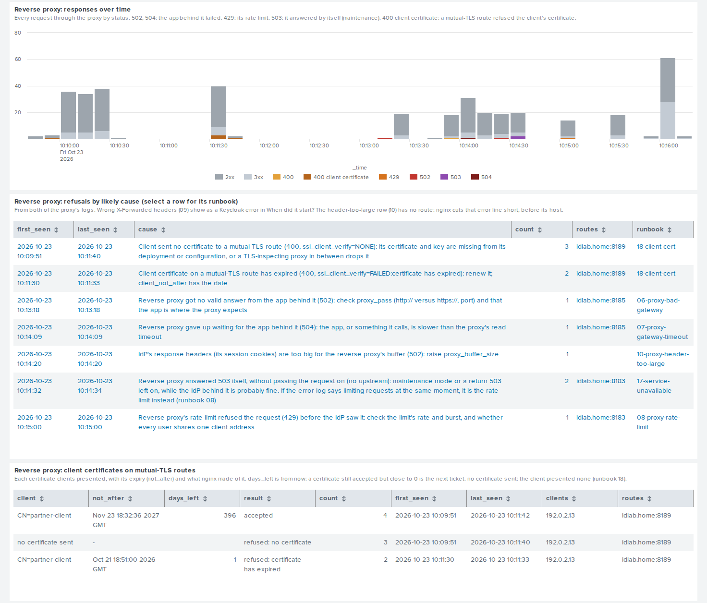
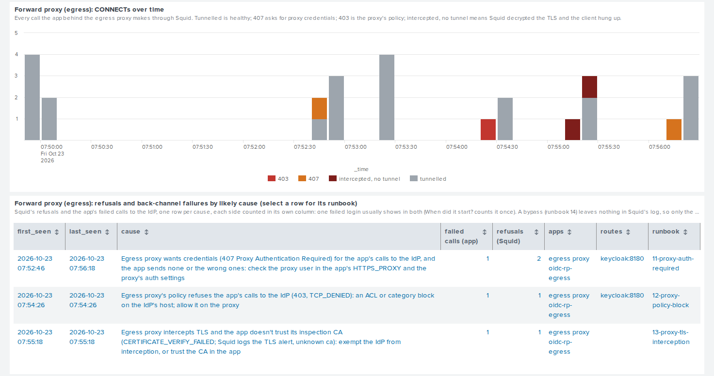

# Identity Support for Splunk

**identity-support-splunk is a Splunk app that answers the three
questions every support ticket starts with: when did it start, who is
affected, and what is the likely cause?** It reads the logs from every
part of [identity-lab](https://github.com/MarkHawk/identity-lab) (the
identity provider, the SAML and OIDC sample apps, the nginx reverse proxy
in front of them, the Squid egress proxy behind one of them, the API that
checks the OIDC app's access tokens, the RADIUS server and NAS, and the
LDAP directory), plus the JSON reports from
[token-inspector](https://github.com/MarkHawk/token-inspector) and
[rate-limit-probe](https://github.com/MarkHawk/rate-limit-probe). Each
failure is matched to a likely cause and a link to the identity-lab
runbook that explains it.

It ships with sample data captured from a real identity-lab run, so
you can try it without the lab.


*Support overview: failures, users affected, first and latest failure, and failures over time by likely cause.*


*When did it start? Each likely cause with its first and last occurrence, who is affected and its runbook.*


*Who is affected? End users and service accounts, with RADIUS rejects versus no reply and LDAP result 49 below.*


*Reverse proxy: responses over time by status, and each 502, 504 or 429 with its likely cause, route and runbook.*


*Forward proxy (egress): the app's calls through Squid over time, and each 407, 403 or TLS interception refusal with its likely cause, apps, route and runbook.*

The screenshots show real identity-lab data. Times are shown in the Splunk user's time zone (UK time in these screenshots).

## Try it in 5 minutes

You need Docker with Compose, Python 3.12 or later, and about 2 GB of
free disk space for the Splunk image.

```
git clone https://github.com/MarkHawk/identity-support-splunk
cd identity-support-splunk
python3 scripts/init_env.py
docker compose up -d
```

- `init_env.py` writes a gitignored `.env` with a random admin password and
  HEC token. It never prints them.
- `docker compose up -d` downloads Splunk Enterprise 10.4.4 the first time
  (about 1.5 GB, so a few minutes on a typical connection). It then starts
  Splunk, which takes another minute or two, and waits until Splunk reports
  healthy. A loader container then sends the samples, with times moved so the
  newest event is a minute old. `docker compose logs loader` shows what it sent.

Then open <http://localhost:18000> and sign in as `admin` with the
`SPLUNK_PASSWORD` value from `.env`. The app opens on **Support overview**
with the last 4 hours.

When you've finished, `docker compose down -v` removes the stack and its
data. Everything listens on 127.0.0.1 only, on ports 18000 (web), 18088
(HEC) and 18089 (management): Splunk's defaults plus 10000, so they don't
clash with a Splunk you already run.

## What you see

**Support overview**
- Failures, users affected, and the first and latest failure.
- Failures over time, stacked by likely cause. The bucket size follows the
  data, not the time picker (the `support_chart` macro). A two-minute
  incident shows as a dozen 10-second columns, not one sliver in a 4-hour
  chart.
- *When did it start?* One row per cause with first and last seen, count,
  who is affected, apps and routes. A redirect loop counts once per
  browser that gave up, not once per redirect, and a failed login through
  the egress proxy counts once, though Squid and the app both log it. The
  expired-token row names the tokens' lifetime (`exp - iat`) and says when
  it is very short. Select a row to open its runbook (or,
  for a cause no runbook covers, identity-lab's list of runbooks). *affected*
  shows one of three things:
  - a number of end users, where the logs name them;
  - the service account, for a directory bind such as
    `service account (keycloak-svc)`;
  - *not in log*, where a failure happens before the user is known, such as
    a SAML response the SP rejects.
- *Who is affected?* End users and service accounts, each with their apps
  and causes. A failed bind as `uid=...` counts as that user's own password
  being rejected, not as an outage.
- *Reverse proxy: responses over time.* Every request through the proxy by
  status, with 2xx and 3xx grouped and each error code on its own.
- *Reverse proxy: 5xx and 429 by likely cause.* One row per reason in the
  proxy's error log (bad gateway, gateway timeout, rate limit, IdP headers
  too large), with the route and the runbook. Wrong `X-Forwarded-*`
  headers leave nothing in nginx's logs. They show in *When did it start?*
  as the Keycloak error they cause, under the app `keycloak (via proxy)`.
- *Forward proxy (egress): CONNECTs over time.* Every call the app behind
  the egress proxy makes through Squid: tunnelled, 407, 403, or
  intercepted with no tunnel.
- *Forward proxy (egress): refusals and back-channel failures by likely
  cause.* Squid's refusals and the app's failed calls to the IdP, one row
  per cause, each side counted in its own column: proxy credentials (407), policy (403), TLS interception the
  app doesn't trust, and the proxy bypassed by `NO_PROXY`, which only the
  app shows because Squid never sees the call.
- *API (bearer tokens): calls over time by result.* Every call to the API:
  accepted, or refused by reason (wrong audience, expired, no token, not a
  JWT, ...).
- *API (bearer tokens): rejections by reason.* Status, count, the clients
  (`azp`) the tokens were issued to, the audiences (`aud`) they carry, and
  the lifetime of the expired ones.
- *RADIUS: Access-Reject versus no reply.* A reject means the server
  answered no. No reply means it dropped or ignored the request (a shared
  secret mismatch, or an unknown NAS), which users see as a timeout.
- *LDAP binds refused by the directory* (result 49, invalid credentials),
  next to the identity provider's own LDAP errors.

**Tool reports**
- token-inspector verdicts, likely causes and failed checks, with runbook
  links.
- rate-limit-probe reports: 429s seen, verdict, likely cause and problems
  found.

**Alerts** (Activity > Triggered Alerts; no actions are configured)

| Alert | Fires when | Runbook |
|---|---|---|
| SSO failure rate jumped | 5 or more failed SSO logins in 10 minutes, and over 3 times the previous hour's rate | 01 to 04 |
| RADIUS server not responding | any request dropped or ignored in the last 5 minutes | 05 |
| LDAP bind failing (result 49) | a service account's bind, or the IdP's LDAP federation, fails with 49 in the last 15 minutes (one user's wrong password does not count) | 04 |
| SAML certificate or clock problem | the SP refuses logins for a certificate or clock reason in the last 15 minutes | 01, 02 |
| Reverse proxy 502/504 spike | the proxy answers 502 or 504 at least 3 times in 5 minutes; lists the reasons from its error log | 06, 07, 10 |
| Reverse proxy rate limiting logins | the proxy's rate limit refuses at least 3 requests (429) in 5 minutes | 08 |
| Egress proxy refusing the IdP | the egress proxy refuses the app's calls to the IdP (407, 403, or TLS interception) in the last 5 minutes, from Squid's logs or the app's | 11, 12, 13 |
| App stuck in a redirect loop | an app redirects the same path to itself 5 or more times, each within 2 seconds of the last, in the last 10 minutes; one loop is enough | 15 |
| rate-limit-probe found a problem | a report in the last hour has a FAIL | (the report's own next step) |

The samples set off the LDAP and SAML alerts at the next five-minute run.
The RADIUS, proxy 502/504 and egress alerts look back only five minutes, so they
can miss them by the time they run. The capture is also too short for the
SSO spike, and has a single 429, below the rate-limit alert's threshold. On Splunk
Free there is no alerting: the same searches still run as reports. The API's
rejections have no alert: they show in the dashboard's API row.

**Scenario coverage:** every identity-lab scenario, and where it shows.

| Runbook | Scenario | Shows in |
|---|---|---|
| 01 | Expired or rotated SAML signing certificate | When did it start? (`saml-sp`), SAML alert |
| 02 | Clock skew | When did it start? (`saml-sp`), SAML alert |
| 03 | Redirect URI mismatch | When did it start? (Keycloak), SSO alert |
| 04 | LDAP bind failure | When did it start? (service account), LDAP panel and alert |
| 05 | RADIUS shared secret mismatch | When did it start? (`radius`), RADIUS panel and alert |
| 06, 07, 10 | Reverse proxy 502, 504, headers too large | Reverse proxy row, When did it start?, 502/504 alert |
| 08 | Reverse proxy rate limit | Reverse proxy row, When did it start?, rate-limit alert |
| 09 | Wrong `X-Forwarded-*` headers to the IdP | When did it start? (`keycloak (via proxy)`) |
| 11 to 13 | Egress proxy: credentials, policy, TLS interception | Forward proxy row, When did it start?, egress alert |
| 14 | Egress proxy bypassed (`NO_PROXY`) | Forward proxy row, When did it start? (`oidc-rp-egress`) |
| 15 | Redirect loop behind the reverse proxy | When did it start? (`oidc-rp-edge`), redirect-loop alert |
| 16 | API 401: wrong audience, expired token | API row, When did it start? (`api`) |

## How it works

Container logs are shipped as `docker logs --timestamps` output, so every
event is timed by Docker's clock, the same for every component (slapd's own
timestamps are hexadecimal). Those timestamps are UTC, and every panel
shows them in the viewer's own Splunk time zone. After you change your time
zone in Splunk, sign out and in again: tables and tiles follow at once, but
chart axes keep the zone the session started with. Line breaking only splits where a new event
starts, so a Java stack trace or a Python traceback stays whole.

| Sourcetype | From | Key fields |
|---|---|---|
| `idlab:keycloak` | identity provider | `kc_type`, `kc_error`, `kc_clientId`, `kc_username`, `ldap_result_code` (from stack traces) |
| `idlab:sp` | SAML SP and OIDC RP, and their copies behind the proxies | `event`, `reason`, `error`, `name_id` / `email`; `app` ends in `-proxied`, `-egress` or `-edge` for the copies; `path`, `scheme`, `x_forwarded_proto` on a forced HTTPS redirect; health checks dropped at index time |
| `idlab:api` | API (resource server) | `reason` (wrong_audience, expired, no_token, ...), `status` (401, or 400 for a malformed header), `sub`, `azp`, `aud`, `iss`, `exp`, `iat`, `token_lifetime` (`exp - iat`, seconds); a claim the token lacks is no field; never the token |
| `idlab:nginx:access` | reverse proxy access log | `status`, `request`, `src`, `site`, `upstream`, `upstream_status`, `request_time`, `upstream_time`, `upstream_response_time` (seconds, from the last upstream tried) |
| `idlab:nginx:error` | reverse proxy error log | `log_level`, `nginx_reason` (the reason text), `src`, `request`, `upstream`, `site`, `limit_zone`; `app` is `proxy` and `route` the host and port for a refusal |
| `idlab:squid:access` | egress proxy access log (Squid's native format) | `result_code`, `status`, `action` (allowed, blocked), `http_method`, `url`, `dest_host`, `dest_port`, `src`, `user`, `hierarchy_code`, `duration` |
| `idlab:squid:cache` | egress proxy cache.log | `log_level`, `squid_message`, `squid_error_detail`, `tls_lib_err` and `tls_error` (OpenSSL's code and text: `A000418` is `tlsv1 alert unknown ca`) |
| `idlab:radius` | RADIUS server | `radius_result`, `radius_outcome` (Access-Accept, Access-Reject, no reply), `user`, `nas_client` |
| `idlab:nas` | NAS client output | `nas_result`, `radius_outcome`, `attempts` |
| `idlab:slapd` | LDAP directory | `conn`, `op`, `bind_dn`, `err` (a bind is two lines, joined on `conn` and `op`) |
| `token_inspector:report` | token-inspector `--json` | `verdict`, `likely_cause`, `runbook_url` |
| `rate_limit_probe:report` | rate-limit-probe `--json` | `verdict`, `likely_cause`, `target_url`, `status_429` |

- **CIM:** login events map to the Authentication data model (`action`,
  `app`, `dest`, `src`, `user`, `reason`, `signature`), tagged
  `authentication`. So do the directory's failed binds, and the API's
  accepted and refused tokens (`app` is `api`, `user` the token's `sub`). The proxies'
  access logs map to the Web data model, tagged `web` (and `proxy` for
  Squid's).
- **The proxy's two logs** arrive in one stream from the container, as
  `idlab:nginx`. Each line is typed `idlab:nginx:access` or
  `idlab:nginx:error` at index time, so the typing does not depend on
  how the lines reach Splunk. nginx cuts a long error line short, so a
  line for a SAML request can end without its upstream and host. Squid's
  access log and cache.log are typed the same way from `idlab:squid`;
  cache.log's indented detail lines stay with their message.
- **Likely cause:** each failure gets a short `signature`, such as
  `saml_clock_skew` or `radius_bad_shared_secret`. The
  [`support_causes`](identity_support/lookups/support_causes.csv) lookup
  turns it into a cause, a runbook and its URL.
- **Redirect loops:** the app's `force_https` line names no client, and
  behind a proxy that lost `X-Forwarded-For` every client has the proxy's
  address anyway. The `` `support_redirect_loops` `` macro groups the
  redirects by host, app copy, path and the `X-Forwarded-Proto` that
  arrived: 5 or more, each within 2 seconds of the last, are one loop. A
  lone redirect (someone typing `http://`) is not.
- **Counting once:** the `` `support_count_once_per_login` `` macro marks
  a Squid refusal that the egress app also logged (same cause, within 2
  seconds) so the overview's counts don't double it.
- **Index:** everything lives in the `identity_support` index (90 days).
  Searches go through the `` `support_index` `` macro, so pointing the app
  at another index is a one-line change in `local/macros.conf`. The egress
  alert counts Squid's refusals for the IdP's host only, from the
  `` `egress_idp_hosts` `` macro (`dest_host=keycloak`).

## Install it on your own Splunk

1. Package the app:

   ```
   python3 scripts/package_app.py   # writes dist/identity_support-<version>.tgz
   ```

   What changed between versions is in [CHANGELOG.md](CHANGELOG.md).

2. Install it, either:
   - in Splunk Web: *Apps > Manage Apps > Install app from file*; or
   - from the CLI: `splunk install app <file> -auth admin`.

3. Restart Splunk. The app creates the `identity_support` index.
4. Create a HEC token whose default index is `identity_support`, or one
   allowed to write to it.

If your Splunk runs in a local container from the `splunk/splunk` image,
step 4 and the sender's settings are one command:

```
python3 scripts/connect_local_splunk.py --container splunk
```

It does four things, printing each step and what success looks like:
- creates the HEC token in the container (or reuses one with the same name);
- saves `HEC_URL`, `HEC_TOKEN` and `HEC_INDEX` in `.env`, readable by you
  only;
- copies Splunk's CA certificate to `splunk-ca.pem`;
- sends one test report over verified TLS.

The token is never printed.

## Send your own data

`sender/hec_send.py` uses only the Python standard library. It reads
`HEC_URL`, `HEC_TOKEN` and `HEC_INDEX` from the environment or `.env` and
never prints the token.

```
python3 sender/hec_send.py docker --since 30m          # identity-lab container logs
python3 sender/hec_send.py report report.json          # a token-inspector or rate-limit-probe --json report
python3 sender/hec_send.py replay samples --shift-to-now
```

- **Where things go:** container logs go to HEC's raw endpoint, so the app's
  `props.conf` breaks lines and reads times exactly as it would for a file.
  Reports go to the event endpoint with their own time.
- **Checking first:** `--dry-run` reads and counts without sending.
- **Directory noise:** the directory's routine search lines are dropped by
  default. That means each `SRCH` request and its successful
  `SEARCH RESULT`. Binds, failed results and connections are always sent,
  and the summary line says how many lines were skipped.
  `--keep-ldap-searches` sends everything.

TLS is always verified. For Splunk's default self-signed certificate, trust
the CA that signed it and name the certificate:

```
docker cp <container>:/opt/splunk/etc/auth/cacert.pem splunk-ca.pem
python3 sender/hec_send.py --cacert splunk-ca.pem --tls-server-name SplunkServerDefaultCert docker --since 30m
```

Splunk's default certificate also trips Python's strict certificate mode,
which is on by default from Python 3.13. Older Splunk images in
particular issue certificates without an Authority Key Identifier, which
strict mode refuses. So when you pass `--cacert`, and only then, the sender
clears that one strict-mode flag. Everything else is still checked: the
certificate must chain to the CA you named, and its name must match the
host or `--tls-server-name`. Without `--cacert` nothing is relaxed.

Splunk's default certificate is fine for a lab. In production, give HEC a
certificate issued properly for its host name by your own CA, and pass
that CA with `--cacert`.

`--insecure` also works, but only when `HEC_URL` points at `localhost` or
`127.0.0.1`. For any other host it is refused.

## Capture new samples

`scripts/capture_lab.py` never changes the lab. It records the start time,
tells you to run identity-lab's own end-to-end test (which breaks and fixes
every scenario), and waits for you. It then collects the lab's logs for
that window and the tools' reports into `captures/raw/` (gitignored), and
writes a sanitised copy to `samples/`.

`scripts/sanitise.py` does the sanitising:
- Each private address becomes its own documentation address, the same in
  every file.
- Personal email addresses, home directories and the personal strings in
  your local `.personal-patterns` are replaced.
- Single-use login values in URLs (authorisation codes, `state`, `nonce`,
  Keycloak's session codes, SAML requests and responses, signatures)
  become `masked-<name>-N`. The same value gets the same name everywhere,
  so a `state` still links an authorisation request to its callback.
  Values identity-lab already masks itself, as `***`, stay as they are.
- Tokens are credentials until they expire: `access_token`, `id_token`,
  `refresh_token` and `id_token_hint` values become `masked-<name>-N`,
  and anything shaped like a JWT (`eyJ...eyJ...`) `masked-jwt-N`. The
  final check fails on any left.
- Base64, deflated SAML requests and URL-encoded text are decoded before
  the final check.
- A private key anywhere stops the run.
- Health-check noise is trimmed.

Read the diff before committing.

## Development

```
python3 -m venv venv
venv/bin/pip install -r requirements-dev.txt
venv/bin/pytest
```

- **Offline tests:** the tests reach loopback and nothing else. They run the
  app's own regular expressions against fixtures and the samples, check that
  the sender and `props.conf` agree on event boundaries, and check that
  nothing private is committed.
- **Live tests:** `tests/test_splunk_live.py` checks the calculated fields,
  eventtypes, tags and lookups in a real Splunk. It runs against the reviewer
  stack when `SUPPORT_SPLUNK_MGMT`, `SUPPORT_SPLUNK_PASSWORD`,
  `SUPPORT_HEC_URL` and `SUPPORT_HEC_TOKEN` are set, and is skipped otherwise.
- **CI:** runs the tests, Splunk AppInspect (default and cloud checks) and a
  compose validation. AppInspect needs Python 3.13 or earlier:
  `requirements-appinspect.txt`.

## Related tools

- [identity-lab](https://github.com/MarkHawk/identity-lab): a Docker identity
  lab that reproduces SAML, OIDC, LDAP and RADIUS failures on demand, each
  with a support runbook. This app's runbook links point there.
- [token-inspector](https://github.com/MarkHawk/token-inspector): explains
  offline what is wrong with a SAML response or a JWT.
- [rate-limit-probe](https://github.com/MarkHawk/rate-limit-probe): explains
  why an integration keeps getting `429 Too Many Requests`.

## A note on how this was built

This app was written with AI-assisted tooling (Claude Code).

## Licence

MIT. See [LICENSE](LICENSE).
