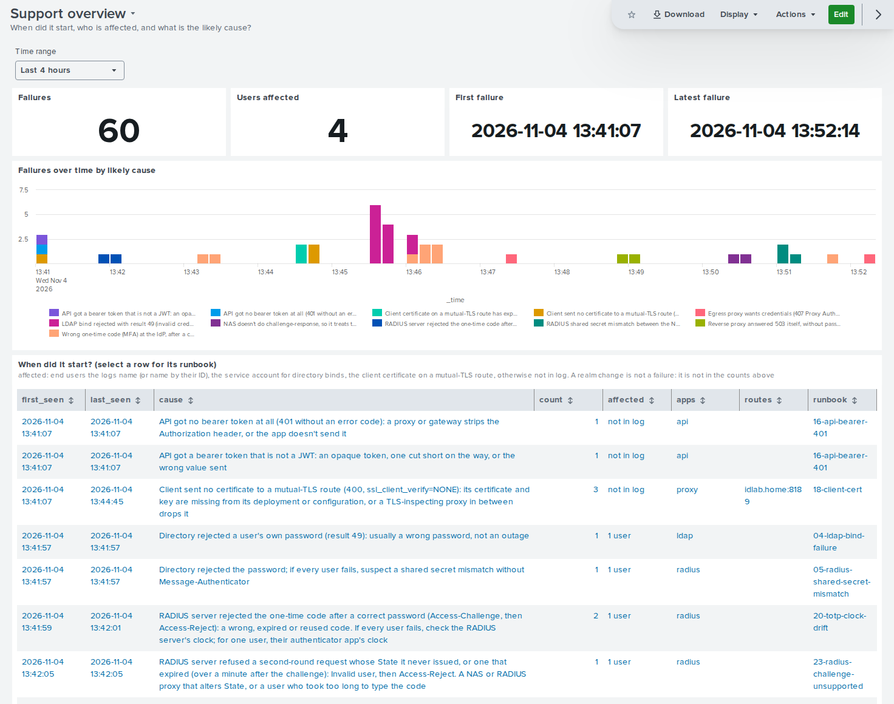
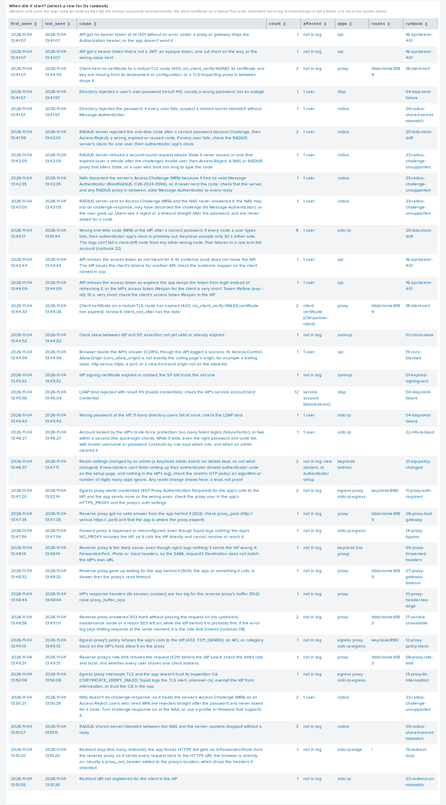
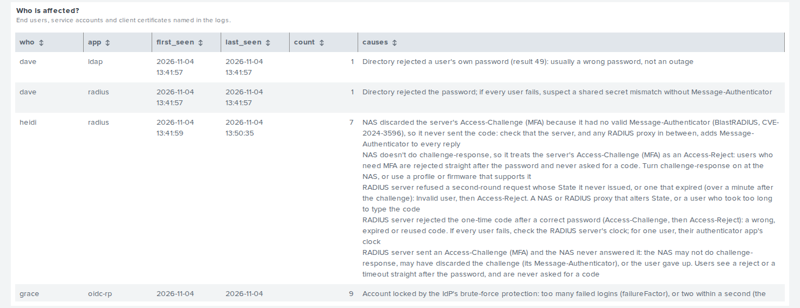
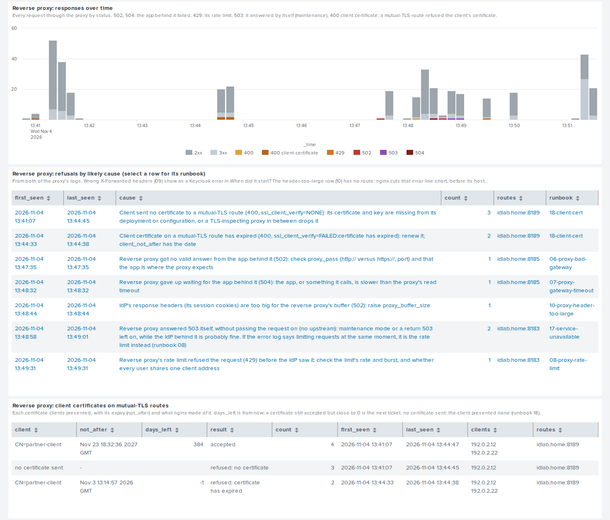
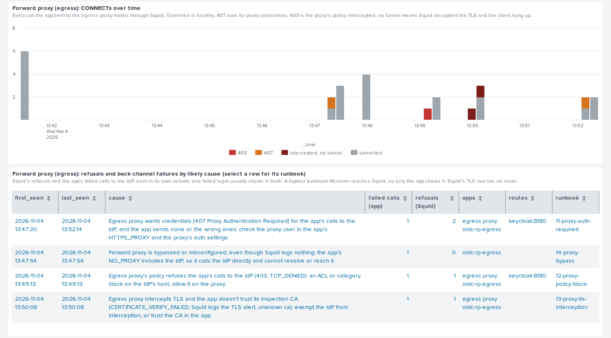
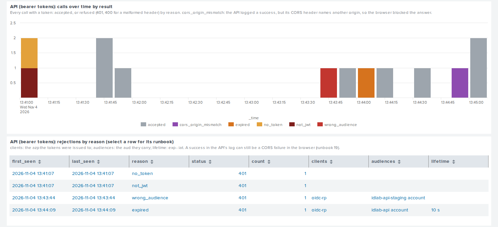
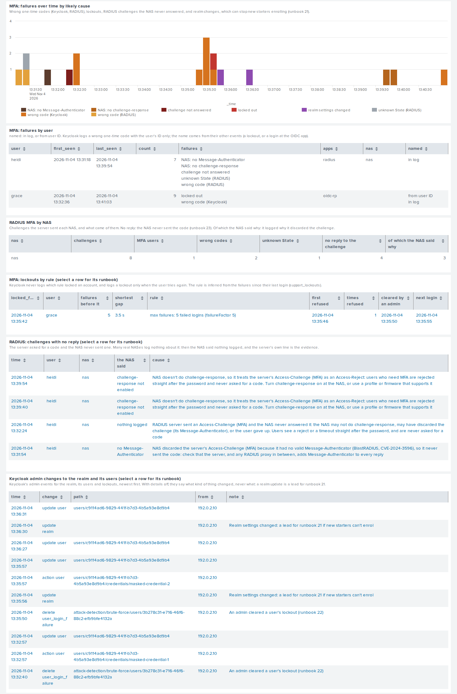

# Identity Support for Splunk

**A Splunk app that answers the three questions every identity support
ticket starts with: when did it start, who is affected, and what is the
likely cause? Each answer links the
[identity-lab](https://github.com/MarkHawk/identity-lab) runbook that
explains it.**

It comes with sample data from a real identity-lab run, so you can try it
without the lab. [How it works](#how-it-works) lists the logs and reports
it reads.


*Support overview: failures, users affected, and failures over time by likely cause.*

The screenshots show real identity-lab data, in the Splunk user's time zone
(UK time here).

## Try it in 5 minutes

You need Docker with Compose, Python 3.12 or later, and about 2 GB of
free disk space for the Splunk image.

```
git clone https://github.com/MarkHawk/identity-support-splunk
cd identity-support-splunk
python3 scripts/init_env.py
docker compose up -d
```

- `init_env.py` writes a gitignored `.env` with a random admin password and
  HEC token. It never prints them.
- `docker compose up -d` downloads Splunk Enterprise 10.4.4 the first time
  (about 1.5 GB, so a few minutes on a typical connection). It then starts
  Splunk, which takes another minute or two, and waits until Splunk reports
  healthy. A loader container then sends the samples, with times moved so the
  newest event is a minute old. `docker compose logs loader` shows what it sent.

Then open <http://localhost:18000> and sign in as `admin` with the
`SPLUNK_PASSWORD` value from `.env`. The app opens on **Support overview**
with the last 4 hours.

When you've finished, `docker compose down -v` removes the stack and its
data. Everything listens on 127.0.0.1 only, on ports 18000 (web), 18088
(HEC) and 18089 (management): Splunk's defaults plus 10000, so they don't
clash with a Splunk you already run.

## What you see

**Support overview** is one dashboard, from top to bottom:

- **Tiles and chart:** failures, users affected, and the first and latest
  failure. Below them, failures over time, stacked by likely cause. The
  bucket size follows the data, not the time picker (the `support_chart`
  macro), so a two-minute incident shows as a dozen 10-second columns.


*When did it start? Each likely cause with its first and last occurrence, who is affected and its runbook.*

- **When did it start?** One row per cause: first and last seen, count, who
  is affected, apps and routes. Select a row to open its runbook. A cause
  no runbook covers opens identity-lab's list of runbooks.
  - A redirect loop counts once per browser that gave up, not once per
    redirect.
  - A failed login through the egress proxy counts once, though Squid and
    the app both log it.
  - The expired-token row names the tokens' lifetime (`exp - iat`) and
    says when it is very short.
  - A change to the realm's settings is a row too (runbook 21), though it
    is not a failure. It is left out of the tiles and the main chart.
  - *affected* is one of four things: a number of end users, where the
    logs name them; a service account, such as
    `service account (keycloak-svc)`; a client certificate on a
    mutual-TLS route, such as `client certificate (CN=partner-client)`; or
    *not in log*, where the failure happens before the user is known (a
    SAML response the SP rejects, for example).


*Who is affected? End users, service accounts and client certificates, with RADIUS and LDAP below.*

- **Who is affected?** Each end user, service account and client
  certificate, with their apps and causes. A failed bind as `uid=...` is
  that user's own password being rejected, not an outage.
- **RADIUS: Access-Reject versus no reply.** A reject means the server
  answered no. No reply means it dropped or ignored the request (a shared
  secret mismatch, or an unknown NAS), which users see as a timeout.
- **LDAP binds refused by the directory** (result 49, invalid
  credentials), next to the identity provider's own LDAP errors.


*Reverse proxy: responses by status, refusals by likely cause, and client certificates with their expiry.*

- **Responses over time:** every request through the proxy by status, with
  2xx and 3xx grouped. A refused client certificate shows as
  `400 client certificate`, apart from the IdP's own 400s. nginx sends
  both as a plain 400: its 495 and 496 never reach the wire.
- **Refusals by likely cause:** one row per cause, with route and runbook.
  Bad gateway, gateway timeout, rate limit and IdP headers too large come
  from the error log. A 503 the proxy answered itself (maintenance mode)
  and a refused client certificate come from the access log.
- **Client certificates on mutual-TLS routes:** each certificate clients
  presented, its expiry (`not_after`), days left and what nginx made of
  it. One still accepted but close to 0 days is the next ticket.
- Wrong `X-Forwarded-*` headers leave nothing in nginx's logs. They show
  in *When did it start?* as the Keycloak error they cause, under the app
  `keycloak (via proxy)`.


*Forward proxy (egress): the app's calls through Squid, and each refusal with its likely cause.*

- **CONNECTs over time:** every call the app behind the egress proxy makes
  through Squid: tunnelled, 407, 403, or intercepted with no tunnel.
- **Refusals and back-channel failures by likely cause:** Squid's
  refusals and the app's failed calls to the IdP, each side in its own
  column. The causes are proxy credentials (407), policy (403), TLS
  interception the app doesn't trust, and the proxy bypassed by
  `NO_PROXY`. Only the app shows the bypass, because Squid never sees the
  call.


*API (bearer tokens): calls by result, and each rejection with its clients, audiences and token lifetime.*

- **Calls over time by result:** accepted, or refused by reason (wrong
  audience, expired, no token, not a JWT, ...). `cors_origin_mismatch` is
  a call the API accepted, from a page whose origin its
  `Access-Control-Allow-Origin` doesn't match, so the browser blocked the
  answer. It counts as a failure in *When did it start?* (runbook 19).
- **Rejections by reason:** status, count, the clients (`azp`) the tokens
  were issued to, the audiences (`aud`) they carry, and the lifetime of
  the expired ones.


*MFA: failures by likely cause, by user and by NAS, lockouts by rule, RADIUS challenges with no reply, and Keycloak's admin changes.*

- **Failures over time by likely cause:** wrong one-time codes at Keycloak
  and at the RADIUS server, lockouts, RADIUS challenges the NAS never
  answered, and changes to the realm's settings.
- **Failures by user:** each user, with their apps and NASes, and where
  their name came from. Keycloak logs a wrong code with the user's ID
  only (see [How it works](#how-it-works)).
- **RADIUS MFA by NAS:** the challenges the server sent each NAS, wrong
  codes, unknown `State`, and challenges with no reply, with how many of
  those the NAS explained.
- **Lockouts by rule:** each lockout, the failures before it, the shortest
  gap between two, and the rule that most likely fired. Also the first
  refusal, and when an admin cleared it or the user next logged in.
  Keycloak never logs the rule, so it is inferred.
- **RADIUS challenges with no reply:** each one, and what the NAS said, if
  anything. Many real NASes log nothing about it.
- **Keycloak admin changes:** admin events for the realm, its users and
  lockouts, newest first. With details off, an event says what kind of
  thing changed, never what changed in it. So a realm update is a lead
  for runbook 21, not proof.

**Tool reports** is the second dashboard:
- token-inspector verdicts, likely causes and failed checks, with runbook
  links.
- rate-limit-probe reports: 429s seen, verdict, likely cause and problems
  found.

### Alerts

In Activity > Triggered Alerts. No actions are configured.

| Alert | Fires when | Runbook |
|---|---|---|
| SSO failure rate jumped | 5 or more failed SSO logins in 10 minutes, and over 3 times the previous hour's rate | 01 to 04 |
| RADIUS server not responding | any request dropped or ignored in the last 5 minutes | 05 |
| LDAP bind failing (result 49) | a service account's bind, or the IdP's LDAP federation, fails with 49 in the last 15 minutes (one user's wrong password does not count) | 04 |
| SAML certificate or clock problem | the SP refuses logins for a certificate or clock reason in the last 15 minutes | 01, 02 |
| Reverse proxy 502/504 spike | the proxy answers 502 or 504 at least 3 times in 5 minutes; lists the reasons from its error log | 06, 07, 10 |
| Reverse proxy rate limiting logins | the proxy's rate limit refuses at least 3 requests (429) in 5 minutes | 08 |
| Egress proxy refusing the IdP | the egress proxy refuses the app's calls to the IdP (407, 403, or TLS interception) in the last 5 minutes, from Squid's logs or the app's | 11, 12, 13 |
| Account locked out | a lockout first refused in the last 15 minutes, with the rule that most likely fired and whether an admin has cleared it; one alert per user | 22 |
| RADIUS MFA challenge with no reply | the NAS never answered a challenge for a one-time code, in the last 10 minutes, once the challenge is a minute old | 23 |
| App stuck in a redirect loop | an app redirects the same path to itself 5 or more times, each within 2 seconds of the last, in the last 10 minutes; one loop is enough | 15 |
| rate-limit-probe found a problem | a report in the last hour has a FAIL | (the report's own next step) |

In a test on 2026-11-04, the first five-minute run, three minutes after
the samples loaded, set off seven alerts: account locked out, RADIUS MFA
challenge with no reply, LDAP, SAML, egress, redirect loop and the SSO
spike. The rest stayed quiet:
- the RADIUS-not-responding and proxy 502/504 alerts look back only five
  minutes, and their scenarios come early in the capture;
- its single 429 is below the rate-limit alert's threshold.

The egress and redirect-loop alerts also look back only 5 and 10
minutes, so they can miss the samples if the first run comes later. The
lockout and RADIUS MFA alerts look back 15 and 10 minutes, and their
scenarios come late in the capture.

On Splunk Free there is no alerting, but the same searches still run as
reports. The API's rejections, the proxy's maintenance 503, refused client
certificates and CORS mismatches have no alert. They show in the dashboard
only. The 502/504 alert counts only the reasons in the error log, never
those.

### Scenario coverage

Every identity-lab scenario, and where it shows.

| Runbook | Scenario | Shows in |
|---|---|---|
| 01 | Expired or rotated SAML signing certificate | When did it start? (`saml-sp`), SAML alert |
| 02 | Clock skew | When did it start? (`saml-sp`), SAML alert |
| 03 | Redirect URI mismatch | When did it start? (Keycloak), SSO alert |
| 04 | LDAP bind failure | When did it start? (service account), LDAP panel and alert |
| 05 | RADIUS shared secret mismatch | When did it start? (`radius`), RADIUS panel and alert |
| 06, 07, 10 | Reverse proxy 502, 504, headers too large | Reverse proxy row, When did it start?, 502/504 alert |
| 08 | Reverse proxy rate limit | Reverse proxy row, When did it start?, rate-limit alert |
| 09 | Wrong `X-Forwarded-*` headers to the IdP | When did it start? (`keycloak (via proxy)`) |
| 11 to 13 | Egress proxy: credentials, policy, TLS interception | Forward proxy row, When did it start?, egress alert |
| 14 | Egress proxy bypassed (`NO_PROXY`) | Forward proxy row, When did it start? (`oidc-rp-egress`) |
| 15 | Redirect loop behind the reverse proxy | When did it start? (`oidc-rp-edge`), redirect-loop alert |
| 16 | API 401: wrong audience (16a `api-bearer-audience`), expired token (16b `api-bearer-expired`) | API row, When did it start? (`api`) |
| 17 | Reverse proxy 503: maintenance mode left on | Reverse proxy row, When did it start? (`proxy`) |
| 18 | Mutual TLS: no client certificate (18a `client-cert-missing`), or an expired one (18b `client-cert-expired`) | Reverse proxy row and its client certificates, When did it start? (`proxy`, the certificate as affected) |
| 19 | CORS: the API answers 200, the browser blocks it | API row (`cors_origin_mismatch`), When did it start? (`api`) |
| 20 | TOTP clock drift: every code the user types fails | MFA row, When did it start? (`oidc-rp`, the user named through their ID) |
| 21 | OTP policy changed: new starters can't set up an authenticator | MFA row (Keycloak admin changes), When did it start? (the realm change; affected not in log). Keycloak logs nothing for the refused code |
| 22 | MFA lockout after wrong codes | MFA row (lockouts by rule), When did it start? (`oidc-rp`), lockout alert |
| 23 | RADIUS MFA: the NAS doesn't do challenge-response | MFA row (by NAS, challenges with no reply), When did it start? (`radius`), RADIUS MFA alert |

## How it works

The app reads the logs from every part of identity-lab:
- the identity provider (Keycloak);
- the SAML and OIDC sample apps;
- the nginx reverse proxy in front of them, and its mutual-TLS route;
- the Squid egress proxy behind one of them;
- the API that checks the OIDC app's access tokens;
- the RADIUS server and NAS;
- the LDAP directory;
- Keycloak's admin events, from its Admin REST API. They never reach its
  log: the `jboss-logging` listener logs them at DEBUG.

It also reads the JSON reports from
[token-inspector](https://github.com/MarkHawk/token-inspector) and
[rate-limit-probe](https://github.com/MarkHawk/rate-limit-probe).

Container logs are shipped as `docker logs --timestamps` output, so every
event is timed by Docker's clock, the same for every component (slapd's own
timestamps are hexadecimal). Those timestamps are UTC, and every panel
shows them in the viewer's own Splunk time zone. After you change your time
zone in Splunk, sign out and in again: tables and tiles follow at once, but
chart axes keep the zone the session started with. Line breaking only splits where a new event
starts, so a Java stack trace or a Python traceback stays whole.

| Sourcetype | From | Key fields |
|---|---|---|
| `idlab:keycloak` | identity provider | `kc_type`, `kc_error`, `kc_clientId`, `kc_username`, `kc_userId`, `kc_selected_credential_id` (a wrong one-time code), `ldap_result_code` (from stack traces) |
| `idlab:keycloak:admin` | Keycloak's admin events (JSON, one per change) | `operationType`, `resourceType`, `resourcePath`; CIM Change `action`, `object_category`, `object_path`, `src`; `unlocked_user_id` when an admin cleared a lockout |
| `idlab:sp` | SAML SP and OIDC RP, and their copies behind the proxies | `event`, `reason`, `error`, `name_id` / `email`; `app` ends in `-proxied`, `-egress` or `-edge` for the copies; `path`, `scheme`, `x_forwarded_proto` on a forced HTTPS redirect; health checks dropped at index time |
| `idlab:api` | API (resource server) | `reason` (wrong_audience, expired, no_token, ...), `status` (401, or 400 for a malformed header), `sub`, `azp`, `aud`, `iss`, `exp`, `iat`, `token_lifetime` (`exp - iat`, seconds); `origin` (a browser page's Origin) and `cors_allow_origin` (the header the API sent) on an accepted call; a claim the token lacks is no field; never the token |
| `idlab:nginx:access` | reverse proxy access log | `status`, `request`, `src`, `site`, `upstream`, `upstream_status`, `request_time`, `upstream_time`, `upstream_response_time` (seconds, from the last upstream tried); on the mutual-TLS route `client_dn`, `client_not_after`, `ssl_client_verify` (SUCCESS, NONE or FAILED:<reason>) and `ssl_client_verify_reason`; `app` is `proxy` and `route` the host and port for a 503 without an upstream or a refused certificate |
| `idlab:nginx:error` | reverse proxy error log | `log_level`, `nginx_reason` (the reason text), `src`, `request`, `upstream`, `site`, `limit_zone`, `ssl_verify_error` and `ssl_client_verify_reason` (a refused client certificate, at info level); `app` is `proxy` and `route` the host and port for a refusal |
| `idlab:squid:access` | egress proxy access log (Squid's native format) | `result_code`, `status`, `action` (allowed, blocked), `http_method`, `url`, `dest_host`, `dest_port`, `src`, `user`, `hierarchy_code`, `duration` |
| `idlab:squid:cache` | egress proxy cache.log | `log_level`, `squid_message`, `squid_error_detail`, `tls_lib_err` and `tls_error` (OpenSSL's code and text: `A000418` is `tlsv1 alert unknown ca`) |
| `idlab:radius` | RADIUS server | `radius_result`, `radius_outcome` (Access-Accept, Access-Reject, Access-Challenge, no reply), `radius_reason`, `radius_invalid_user`, `radius_request_id`, `user`, `nas_client` |
| `idlab:nas` | NAS client output | `nas_result`, `radius_outcome` (also challenge discarded), `nas_discard_reason`, `attempts` |
| `idlab:slapd` | LDAP directory | `conn`, `op`, `bind_dn`, `err` (a bind is two lines, joined on `conn` and `op`) |
| `token_inspector:report` | token-inspector `--json` | `verdict`, `likely_cause`, `runbook_url` |
| `rate_limit_probe:report` | rate-limit-probe `--json` | `verdict`, `likely_cause`, `target_url`, `status_429` |

- **CIM:** login events map to the Authentication data model (`action`,
  `app`, `dest`, `src`, `user`, `reason`, `signature`), tagged
  `authentication`. So do the directory's failed binds, and the API's
  accepted and refused tokens (`app` is `api`, `user` the token's `sub`). The proxies'
  access logs map to the Web data model, tagged `web` (and `proxy` for
  Squid's). Keycloak's admin events map to the Change data model, tagged
  `change`.
- **The proxy's two logs** arrive in one stream from the container, as
  `idlab:nginx`. Each line is typed `idlab:nginx:access` or
  `idlab:nginx:error` at index time, so the typing does not depend on
  how the lines reach Splunk. nginx cuts a long error line short, so a
  line for a SAML request can end without its upstream and host. Squid's
  access log and cache.log are typed the same way from `idlab:squid`;
  cache.log's indented detail lines stay with their message.
- **Likely cause:** each failure gets a short `signature`, such as
  `saml_clock_skew` or `radius_bad_shared_secret`. The
  [`support_causes`](identity_support/lookups/support_causes.csv) lookup
  turns it into a cause, a runbook and its URL.
- **Redirect loops:** the app's `force_https` line names no client, and
  behind a proxy that lost `X-Forwarded-For` every client has the proxy's
  address anyway. The `` `support_redirect_loops` `` macro groups the
  redirects by host, app copy, path and the `X-Forwarded-Proto` that
  arrived: 5 or more, each within 2 seconds of the last, are one loop. A
  lone redirect (someone typing `http://`) is not.
- **What the logs can show:** nginx logs nothing in its error log for a
  503 it answers itself, and gives a refused client certificate's reason
  only at `info` level, so both causes come from the access line, one per
  request. A rate limit set to answer 503 instead of 429 would show as
  both a rate limit and a 503: the 503's cause says so. For CORS, the
  API logs the page's `Origin` and the header it sent, and the app
  compares them; the browser's refusal itself is never in a server log.
  A preflight the browser refuses (an `OPTIONS` with no `GET` after it)
  is not detected.
- **A wrong one-time code at Keycloak** is `invalid_user_credentials`,
  like a wrong password. But at the code step Keycloak names the
  authenticator the user picked (`selected_credential_id`) and not the
  user. A wrong password names the user and no authenticator, even for a
  user with MFA. So `kc_otp_invalid` needs both: a credential, and no
  username.
- **Who is affected by a wrong code:** that line has the user's Keycloak
  ID only. The `` `support_kc_user_from_id` `` macro finds the name on
  another event with the same ID in the same search:
  - Keycloak's own, when one names both (a lockout does);
  - otherwise the OIDC app's login, whose `sub` is the Keycloak ID (the
    name is then its email).

  It can't when nothing else in the time range names that ID: the user
  has had no lockout and no login at an OIDC app that logs one, or only
  uses SAML apps (the SP logs no Keycloak ID). Widening the time range
  helps. The panel says whether each name came from the log or from the
  ID.
- **RADIUS MFA:** FreeRADIUS logs nothing when it sends an
  Access-Challenge, so identity-lab adds a `Challenge sent` line. The
  `` `support_radius_mfa` `` macro reads each line with the ones around
  it, per server, NAS and user:
  - `Login incorrect` with no reason, within 60 seconds of a challenge
    (the server's `State` lasts a minute), is a wrong, expired or reused
    code (runbook 20). A wrong password names the directory's reason, so
    it is never taken for a code, and starts a new attempt.
  - `Invalid user`, then `Login incorrect` with the same request number,
    is a `State` the server never issued (runbook 23).
  - A challenge with no second request within 60 seconds is a failure
    (runbook 23). It is named after the NAS's discard line if there is
    one, and that line is not counted again.
- **Lockouts:** Keycloak logs a lockout only when the locked user tries
  again, and never says which rule locked them. The
  `` `support_lockouts` `` macro infers it from the failures since the
  user's last login (at the OIDC app) or an admin's unlock. Two failures
  under `quickLoginCheckMilliSeconds` apart mean quick login. Otherwise
  `failureFactor` failures mean max failures. Otherwise it says not clear
  from the logs. It uses identity-lab's values (5, and 1000 ms); set your
  realm's in `local/macros.conf`. A login at an app that logs nothing is
  invisible, so the count can be too high. Two logins at the same moment
  can be logged in the wrong order: the lab once logged a lockout before
  the failure that caused it.
- **Counting once:** the `` `support_count_once_per_login` `` macro marks
  a Squid refusal that the egress app also logged (same cause, within 2
  seconds) so the overview's counts don't double it.
- **Index:** everything lives in the `identity_support` index (90 days).
  Searches go through the `` `support_index` `` macro, so pointing the app
  at another index is a one-line change in `local/macros.conf`. The egress
  alert counts Squid's refusals for the IdP's host only, from the
  `` `egress_idp_hosts` `` macro (`dest_host=keycloak`).

## Install it on your own Splunk

1. Package the app:

   ```
   python3 scripts/package_app.py   # writes dist/identity_support-<version>.tgz
   ```

   What changed between versions is in [CHANGELOG.md](CHANGELOG.md).

2. Install it, either:
   - in Splunk Web: *Apps > Manage Apps > Install app from file*; or
   - from the CLI: `splunk install app <file> -auth admin`.

3. Restart Splunk. The app creates the `identity_support` index.
4. Create a HEC token whose default index is `identity_support`, or one
   allowed to write to it.

If your Splunk runs in a local container from the `splunk/splunk` image,
step 4 and the sender's settings are one command:

```
python3 scripts/connect_local_splunk.py --container splunk
```

It does four things, printing each step and what success looks like:
- creates the HEC token in the container (or reuses one with the same name);
- saves `HEC_URL`, `HEC_TOKEN` and `HEC_INDEX` in `.env`, readable by you
  only;
- copies Splunk's CA certificate to `splunk-ca.pem`;
- sends one test report over verified TLS.

The token is never printed.

## Send your own data

`sender/hec_send.py` uses only the Python standard library. It reads
`HEC_URL`, `HEC_TOKEN` and `HEC_INDEX` from the environment or `.env` and
never prints the token.

```
python3 sender/hec_send.py docker --since 30m          # identity-lab container logs
python3 sender/hec_send.py report report.json          # a token-inspector or rate-limit-probe --json report
python3 sender/hec_send.py replay samples --shift-to-now
```

- **Where things go:** container logs go to HEC's raw endpoint, so the app's
  `props.conf` breaks lines and reads times exactly as it would for a file.
  Reports go to the event endpoint with their own time.
- **Admin events:** `replay` also sends `events/keycloak-admin.jsonl`,
  one admin event per line, each at its own time. On a real Keycloak,
  fetch them through the Admin REST API with a dedicated account that can
  only read them (the `realm-management` role `view-events`, nothing
  else), not an admin account. The capture uses the lab's admin account
  only because the lab has no other.
- **Checking first:** `--dry-run` reads and counts without sending.
- **Directory noise:** the directory's routine search lines are dropped by
  default. That means each `SRCH` request and its successful
  `SEARCH RESULT`. Binds, failed results and connections are always sent,
  and the summary line says how many lines were skipped.
  `--keep-ldap-searches` sends everything.

TLS is always verified. For Splunk's default self-signed certificate, trust
the CA that signed it and name the certificate:

```
docker cp <container>:/opt/splunk/etc/auth/cacert.pem splunk-ca.pem
python3 sender/hec_send.py --cacert splunk-ca.pem --tls-server-name SplunkServerDefaultCert docker --since 30m
```

Splunk's default certificate also trips Python's strict certificate mode,
which is on by default from Python 3.13. Older Splunk images in
particular issue certificates without an Authority Key Identifier, which
strict mode refuses. So when you pass `--cacert`, and only then, the sender
clears that one strict-mode flag. Everything else is still checked: the
certificate must chain to the CA you named, and its name must match the
host or `--tls-server-name`. Without `--cacert` nothing is relaxed.

Splunk's default certificate is fine for a lab. In production, give HEC a
certificate issued properly for its host name by your own CA, and pass
that CA with `--cacert`.

`--insecure` also works, but only when `HEC_URL` points at `localhost` or
`127.0.0.1`. For any other host it is refused.

## Capture new samples

`scripts/capture_lab.py` never changes the lab. It records the start time,
tells you to run identity-lab's own end-to-end test (which breaks and fixes
every scenario), and waits for you. It then collects the lab's logs for
that window and the tools' reports into `captures/raw/` (gitignored), and
writes a sanitised copy to `samples/`.

It also fetches the realm's admin events for the window, into
`events/keycloak-admin.jsonl`, with the admin password from the lab's
`.env`. The password and the admin token stay in memory: they are never
written or printed. `scripts/keycloak_admin.py` can only read. It sends
`GET` under `/admin/realms/`, plus the one `POST` that gets the admin
token, and refuses anything else before it connects. `--no-admin-events`
skips it.

`scripts/sanitise.py` does the sanitising:
- Each private address becomes its own documentation address, the same in
  every file.
- Personal email addresses, home directories and the personal strings in
  your local `.personal-patterns` are replaced.
- Single-use login values in URLs (authorisation codes, `state`, `nonce`,
  Keycloak's session codes, SAML requests and responses, signatures)
  become `masked-<name>-N`. The same value gets the same name everywhere,
  so a `state` still links an authorisation request to its callback.
  Values identity-lab already masks itself, as `***`, stay as they are.
- Tokens are credentials until they expire: `access_token`, `id_token`,
  `refresh_token` and `id_token_hint` values become `masked-<name>-N`,
  and anything shaped like a JWT (`eyJ...eyJ...`) `masked-jwt-N`. The
  final check fails on any left.
- MFA values are masked too:
  - TOTP secrets: `otpauth://` URIs, a secret after a name like
    `secret` or `GRACE_TOTP_SECRET`, and Keycloak's setup key in groups
    of four;
  - one-time codes in Keycloak's `otp` and `totp` fields, or next to a
    name such as `otp_code`;
  - credential IDs, as `masked-credential-N`, so one user's code failures
    still share one.

  The capture also passes the lab's own TOTP secrets, from its `.env`,
  held in memory only. They are masked in any case or grouping. The final
  check fails on any MFA value left.
- Base64, deflated SAML requests and URL-encoded text are decoded before
  the final check.
- A private key anywhere stops the run.
- Health-check noise is trimmed.

Read the diff before committing.

## Development

```
python3 -m venv venv
venv/bin/pip install -r requirements-dev.txt
venv/bin/pytest
```

- **Offline tests:** the tests reach loopback and nothing else. They run the
  app's own regular expressions against fixtures and the samples, check that
  the sender and `props.conf` agree on event boundaries, and check that
  nothing private is committed.
- **Live tests:** `tests/test_splunk_live.py` checks the calculated fields,
  eventtypes, tags and lookups in a real Splunk. It runs against the reviewer
  stack when `SUPPORT_SPLUNK_MGMT`, `SUPPORT_SPLUNK_PASSWORD`,
  `SUPPORT_HEC_URL` and `SUPPORT_HEC_TOKEN` are set, and is skipped otherwise.
- **CI:** runs the tests, Splunk AppInspect (default and cloud checks) and a
  compose validation. AppInspect needs Python 3.13 or earlier:
  `requirements-appinspect.txt`.

## Related tools

- [identity-lab](https://github.com/MarkHawk/identity-lab): a Docker identity
  lab that reproduces SAML, OIDC, LDAP and RADIUS failures on demand, each
  with a support runbook. This app's runbook links point there.
- [token-inspector](https://github.com/MarkHawk/token-inspector): explains
  offline what is wrong with a SAML response or a JWT.
- [rate-limit-probe](https://github.com/MarkHawk/rate-limit-probe): explains
  why an integration keeps getting `429 Too Many Requests`.

## A note on how this was built

This app was written with AI-assisted tooling (Claude Code).

## Licence

MIT. See [LICENSE](LICENSE).
